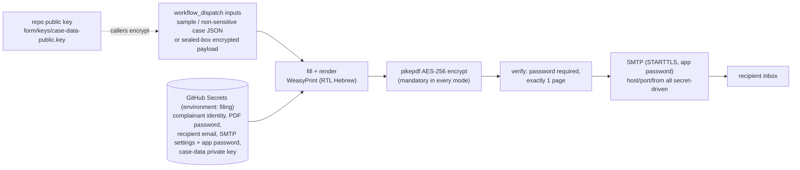

# traffic-complaint-form

[](https://github.com/civic-form-tools/traffic-complaint-form/actions/workflows/ci.yml)
[](https://github.com/civic-form-tools/traffic-complaint-form/actions/workflows/codeql.yml)
[](LICENSE)
[](pyproject.toml)

Fill the Israel Police traffic complaint form (תלונה על עבירת תנועה, Jerusalem
District Traffic Department) from a GitHub Actions workflow, and receive the
filled one-page PDF by email.

**Privacy model:** this repository is public and contains **no personal data**.
The complainant identity (name, ID number, address, phone), the output
encryption secret, the recipient email and the SMTP credentials live only in
one atomic GitHub Secret. Real case data (plates, locations, incident details) never
travels in plaintext either: public workflow inputs and logs would expose it,
so it arrives as a **sealed-box encrypted payload** that only the workflow's
private key (also a Secret) can open.

## How it works



Every run of `Fill and send complaint form` is gated by the **filing**
environment, whose required reviewer must approve before any secret is
exposed to the job.

## Configuration

Use one **FILING_BUNDLE** JSON secret in the protected **filing** environment,
containing the full identity, strong PDF password, recipient and SMTP settings.
The exact placeholder template and cutover/removal checklist are in
[docs/SECRETS.md](docs/SECRETS.md). CASE_DATA_PRIVATE_KEY remains separate.
No individual identity/password/delivery secret is read by the current workflow.
Missing or partial bundles fail closed, including dry runs and sample runs.

TEST_MODE (default true) adds a watermark and a test subject. It does not
prove identity is invented. PDF encryption is mandatory in every mode;
ENCRYPT_OUTPUT=false is rejected and there is no ID-password fallback.

## Running a test pass

Load the complete bundle directly in GitHub, dispatch **Fill and send
complaint form** on main using sample data, and approve the filing gate.
Use dry_run to build and verify without email. CI uses invented fixtures only.
Read the [threat model](docs/SECRETS.md#threat-model-and-trust-boundary):
a bundle prevents partial secret replacement, not malicious approved code.

## Filing a real complaint

Real case data must not appear in public inputs/logs. Encrypt it with the
repository public key and paste the ciphertext into the `encrypted_case`
input:

```bash
traffic-complaint-form-encrypt-case --in case.json --out case.enc
```

The workflow decrypts it in memory; logs and the output filename carry no
plates or locations. The exact payload schema, defaults and caller steps:
[docs/CASE_DATA.md](docs/CASE_DATA.md).

## Development

```bash
pip install -e '.[dev]'
python -m pytest --cov      # coverage floor: 80%
ruff check . && ruff format --check .
```

Design, decisions and alternatives: [docs/DESIGN.md](docs/DESIGN.md).

## Cost

Everything runs on free tiers: public-repository Actions minutes are
unlimited, and a filing run takes about 2-3 minutes.

## License

MIT - see [LICENSE](LICENSE).
