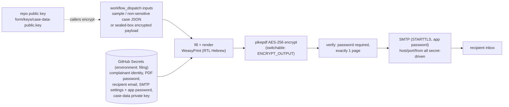

# traffic-complaint-form

[](https://github.com/reihlinstinct/traffic-complaint-form/actions/workflows/ci.yml)
[](https://github.com/reihlinstinct/traffic-complaint-form/actions/workflows/codeql.yml)
[](LICENSE)
[](pyproject.toml)

Fill the Israel Police traffic complaint form (תלונה על עבירת תנועה, Jerusalem
District Traffic Department) from a GitHub Actions workflow, and receive the
filled one-page PDF by email.

**Privacy model:** this repository is public and contains **no personal data**.
The complainant identity (name, ID number, address, phone), the output
encryption secret, the recipient email and the SMTP credentials live only in
GitHub Secrets. Real case data (plates, locations, incident details) never
travels in plaintext either: public workflow inputs and logs would expose it,
so it arrives as a **sealed-box encrypted payload** that only the workflow's
private key (also a Secret) can open.

## How it works



Every run of `Fill and send complaint form` is gated by the **filing**
environment, whose required reviewer must approve before any secret is
exposed to the job.

## Configuration

Secrets (see [docs/SECRETS.md](docs/SECRETS.md) for the full specification):
`COMPLAINANT_FIRST_NAME`, `COMPLAINANT_LAST_NAME`, `COMPLAINANT_ID`,
`COMPLAINANT_ADDRESS`, `COMPLAINANT_PHONE`, `PDF_PASSWORD`, `RECIPIENT_EMAIL`,
`SMTP_HOST`, `SMTP_PORT` (optional, default 587), `SMTP_USERNAME`, `SMTP_APP_PASSWORD`, `SMTP_FROM`, `CASE_DATA_PRIVATE_KEY`.

Repository/environment variables:

| Variable | Default | Meaning |
| --- | --- | --- |
| `TEST_MODE` | `true` | Watermark the PDF (בדיקה - לא לשליחה) and tag the subject `[בדיקה]`. |
| `ENCRYPT_OUTPUT` | `true` | Encrypt the PDF. May be `false` **only** while `TEST_MODE=true` (dummy data); the CLI refuses otherwise. |

PDF password: the dedicated `PDF_PASSWORD` secret is the primary for real data (the user loads a hard-to-guess value himself). Only while `TEST_MODE=true`, an unset `PDF_PASSWORD` falls back to the complainant ID number - low-entropy (9 digits, offline-brute-forceable), an accepted tradeoff for test data only. Outside test mode the run refuses to encrypt without `PDF_PASSWORD`. The value never appears in logs.

## Running a test pass

1. Load the dummy secrets (invented values - see docs/SECRETS.md).
2. Actions -> **Fill and send complaint form** -> enable `sample_data`,
   approve the environment review.
3. An encrypted, watermarked PDF arrives by email. To skip encryption during
   the dummy phase, set `ENCRYPT_OUTPUT=false`.

## Filing a real complaint

Real case data must not appear in public inputs/logs. Encrypt it with the
repository public key and paste the ciphertext into the `encrypted_case`
input:

```bash
traffic-complaint-form-encrypt-case --in case.json --out case.enc
```

The workflow decrypts it in memory; logs and the output filename carry no
plates or locations. The exact payload schema, defaults and caller steps:
[docs/CASE_DATA.md](docs/CASE_DATA.md).

## Development

```bash
pip install -e '.[dev]'
python -m pytest --cov      # coverage floor: 80%
ruff check . && ruff format --check .
```

Design, decisions and alternatives: [docs/DESIGN.md](docs/DESIGN.md).

## Cost

Everything runs on free tiers: public-repository Actions minutes are
unlimited, and a filing run takes about 2-3 minutes.

## License

MIT - see [LICENSE](LICENSE).
