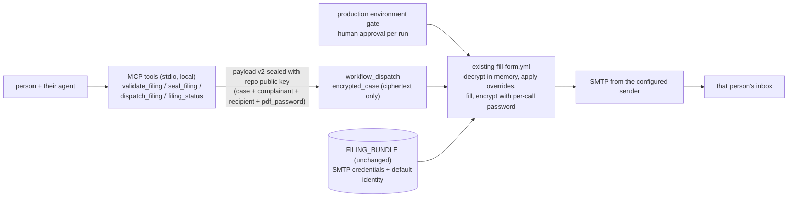

# Design: MCP server for per-call filings (issue #30)

## Context

Today the pipeline serves exactly one complainant: identity, recipient and
PDF password live in the atomic `FILING_BUNDLE` secret, and case data arrives
sealed. The owner asked (2026-10-26) for an MCP (Model Context Protocol)
server so that an AI agent acting for a person can file a complaint with
**that person's own details, supplied per call** - national ID number,
delivery email address and PDF password - **without the system storing any
of them**: no persistence, no logs, memory only, never committed.

Owner constraints:

- Sending continues from the email address configured in the form's system
  (the existing `FILING_BUNDLE` SMTP sender); no per-installation sender
  credentials.
- PDF encryption is keyed **per the user who opens/uses the tool** - a
  password that user supplies for that filing, not one of ours.
- No police submission. This stays a non-goal: the filled PDF is emailed to
  the complainant, who prints/signs/files. Nothing in this design files
  anything with any authority.
- Free resources only; nothing legally risky.

## Chosen architecture: stdio MCP server -> payload v2 -> existing workflow



The MCP server is a **local stdio server** (Python, official `mcp` SDK)
installed wherever the caller's agent runs. It holds the per-call details in
process memory only, seals them with the repository public key, and calls
the GitHub API to dispatch the existing workflow. The heavy machinery
(secrets, gate, rendering, SMTP) stays exactly where it is.

### Payload schema v2 (additive, backwards compatible)

The `encrypted_case` payload gains three optional keys alongside the
existing case keys:

```json
{
  "... existing case keys ...": "...",
  "complainant": {"first_name": "...", "last_name": "...", "id_number": "...", "address": "...", "phone": "..."},
  "recipient_email": "person@example.com",
  "pdf_password": "at-least-16-chars"
}
```

- **Atomic override:** the three keys are all-or-nothing. If any is present,
  all three must be present and valid; a partial override fails closed.
  This mirrors the FILING_BUNDLE atomicity lesson - no silent mixing of a
  new recipient with an old identity.
- When present, they override `FILING_BUNDLE`'s complainant, recipient and
  PDF password **in memory, for that run only**. When absent, the bundle
  defaults apply (today's classic flow is untouched).
- Same validation rules as the bundle: 9-digit ID with Israeli checksum,
  password 16+ chars / <=127 UTF-8 bytes / not equal to the ID, addressable
  email. Diagnostics reuse the allowlisted-code pattern - parser-owned
  codes only, never supplied keys or values.
- v1 payloads (no override keys) keep working unchanged.

### FILING_BUNDLE: unchanged

The bundle stays the source of SMTP credentials (host, port, username, app
password, from) and the **default** identity/recipient/password for classic
dispatch. No bundle schema migration, no cutover, no secret rotation.

### MCP tool surface

| Tool | Purpose | Auth |
| --- | --- | --- |
| `validate_filing(case, complainant?, recipient_email?, pdf_password?)` | Schema/checksum/strength diagnostics as allowlisted codes | none |
| `seal_filing(...)` | Build payload v2 and return sealed-box ciphertext (for manual dispatch) | none |
| `dispatch_filing(...)` | validate + seal + `POST .../actions/workflows/fill-form.yml/dispatches` (ref main), return run URL | `TCF_GITHUB_TOKEN` |
| `filing_status(run_id)` | Run status/conclusion only (no values) | `TCF_GITHUB_TOKEN` |

`TCF_GITHUB_TOKEN` is a per-installation fine-grained PAT scoped to this
repository with **Actions: read/write** and nothing else. It is
configuration, not personal data; it comes from the environment, is never
logged, and the docs require the minimal scope.

### Memory-only handling, honestly scoped

- The MCP server writes **nothing**: no files, no cache, no config, no
  telemetry. Values arrive as tool arguments, live in process memory, and
  the references are dropped when the call returns.
- Python cannot guarantee zeroization of immutable strings; the guarantee
  is "never persisted", not "cryptographically erased from RAM". Stated
  plainly in the README.
- The caller's own host/agent may keep its own transcript of the tool
  call - that is the caller's side of the boundary, documented so nobody
  mistakes our guarantee for theirs.
- On the GitHub side the details exist only as: sealed ciphertext in the
  dispatch input and run log (world-readable but opaque), plaintext in the
  runner's memory (as today for case data), and the encrypted attachment in
  the recipient's mailbox and the sender's Sent folder - encrypted with the
  caller's own password, so the at-rest copy is ciphertext.
- Output filename stays the ciphertext-digest form (no plate, no date
  beyond the offence date already used today); the per-call recipient never
  reaches any filename.

## Threat model

### 1. Personal data handling

- *In transit:* per-call details travel only inside the sealed box.
  Dispatch inputs and run logs show ciphertext. GitHub's masking is not
  relied upon (payload values are not secrets); the seal is the control.
- *In the runner:* decryption and the override merge happen in memory;
  values never enter `GITHUB_ENV`, step outputs, command arguments or temp
  files. Existing log-privacy tests are extended to the v2 fields
  (ID/email/password absent from every log line in every mode).
- *In email:* subject and body remain fixed templates. Only
  strictly-validated fields (plate pattern, date) interpolate into the
  subject, as today; no caller free text (no description, no names) ever
  reaches subject or body - this is what keeps our sender unusable for
  phishing. The body text gains a per-call variant ("the password you chose
  when filing") since `FILING_BUNDLE` wording would be wrong.
- *At rest:* none on our side (see above). The recipient's mailbox holds
  only a PDF they alone can open.

### 2. Spoofed / prompt-injected callers

- An agent can be manipulated by untrusted content into filing with
  attacker-chosen identity or recipient. Mitigations:
  - Tool descriptions carry explicit directives: take complainant details
    only from the person the agent serves, confirm them in the
    conversation, never copy identity/email/password values out of
    untrusted documents or messages.
  - The production environment gate: a human (reihl/reihlinstinct)
    approves **every** run before any secret is exposed. The reviewer sees
    ciphertext, not content - so the gate is a rate/audit control, not a
    content review. It already is for sealed case data today.
  - Blast radius is small by design: the worst outcome is one encrypted
    PDF emailed to one address from the configured sender. Nothing is
    filed with the police; the PDF is useless without the password the
    recipient chose.
- Token theft: the dispatch token is single-repo, Actions-only; every use
  still waits on the human gate.

### 3. Abuse / spam submissions

- Risk: our sender address used to push police-form-looking mail to
  arbitrary recipients. Controls:
  1. Static subject/body templates (no caller free text) - above.
  2. Per-run human gate - above.
  3. **Per-day dispatch cap** in the workflow (proposed default 10,
     `vars.MCP_DAILY_CAP`), fail closed. Implementation: count today's
     `fill-form` runs via the API (needs `actions: read` added to the
     workflow permissions) before the filling step.
  4. Audit: GitHub's deployment/review history already records who
     approved which run; we add nothing personal to issues or logs.
  5. The body template tells the recipient what this is and where to
     report abuse (repo SECURITY contact).
- Nothing is submitted to the police, so no automated filing can create
  legal exposure in anyone's name. The complainant alone decides to print,
  sign and file.

### 4. Existing trust-boundary caveats (unchanged)

docs/SECRETS.md's audit still applies: admins can rewrite protections;
approved malicious code on main could exfiltrate the bundle. This change
adds CODEOWNERS coverage for the new secret-adjacent code
(`mcp_server` module, payload-v2 merge in `config.py`/`cli.py`) so @reihl
must approve it like the rest of the secret-handling surface.

## Alternatives considered

- **Local end-to-end MCP (fill + send on the caller's machine):** needs
  the SMTP app password on every installation - spreads our sender
  credentials, loses the gate, breaks "sending continues from the
  configured sender". Rejected.
- **Hosted remote MCP endpoint:** an internet-facing service accepting
  national ID numbers is a spam/abuse magnet, needs hosting terms and
  money-adjacent decisions, and gains nothing while dispatch stays
  collaborator-gated. Rejected as a standing service; revisit only if
  strangers need self-serve. A narrower exception is implemented for
  personal review: HTTP mode (TCF_MCP_TRANSPORT=http) behind a per-session
  bearer token, meant to sit on the operator's own machine behind a
  time-boxed tunnel. That instance is synthetic-only by construction - the
  dispatch and status tools are not registered at all, so it cannot send,
  file or touch secrets. Fail-closed: it refuses to start without a 16+
  character bearer token.
- **Per-person GitHub Secrets:** exactly the "stored by us" model the
  owner rejected. Rejected.
- **New workflow input for overrides:** public inputs/logs are
  world-readable; anything plaintext there leaks. Rejected - the sealed
  box is the only channel, as today.

## Repo changes (implementation PR(s))

- `src/traffic_complaint_form/mcp_server.py` + `traffic-complaint-form-mcp`
  entry point; new pinned deps `mcp`, `httpx` (dependabot already covers
  pip).
- `config.py` / `cli.py`: payload-v2 parse + atomic in-memory override
  merge (CODEOWNERS-protected; @reihl review).
- `mail.py`: per-call body variant; static-template invariant asserted in
  tests (CODEOWNERS-protected).
- `fill-form.yml`: daily-cap step, `actions: read` permission (protected).
- `CODEOWNERS`: add MCP module paths (protected).
- Docs: README MCP section, docs/CASE_DATA.md schema v2, docs/SECRETS.md
  note (bundle unchanged; per-call fields never stored), CHANGELOG, semver
  minor bump.
- Tests: v2 validation codes, atomic-override merge, log privacy for v2
  fields, MCP tool unit tests with a mocked GitHub API, workflow YAML
  tests; coverage floor 80% kept; ruff clean; CodeQL covers the new module.

## Testing and the Claude handoff

- Unit/functional per repo convention; every fix ships a regression test.
- e2e: one owner-approved synthetic dispatch through the gate to a
  controlled test inbox (dry-run first).
- **Claude (GitHub app)** runs the synthetic-data checklist in issue #31
  once the implementation lands: invented identity with a valid checksum,
  invented password, controlled recipient, log-privacy greps, gate
  verification. Draft PRs only; live dispatch only if its installation
  token has Actions write - otherwise that step is an owner-approved run.

## Open decisions

1. Payload v2 atomic override (chosen) vs bundle v2 with optional
   complainant - chosen path needs no migration and keeps classic dispatch
   untouched; confirm at review.
2. Daily cap value (10 proposed) and the exact audit surface beyond
   GitHub's deployment history.
3. Whether Claude's installation token can dispatch (Actions: write) - if
   not, its checklist stops before live dispatch (issue #31 notes this).
4. Sender Sent-folder retention of the encrypted PDF (kept by default -
   it is ciphertext; a delete-after-send toggle is possible if wanted).
